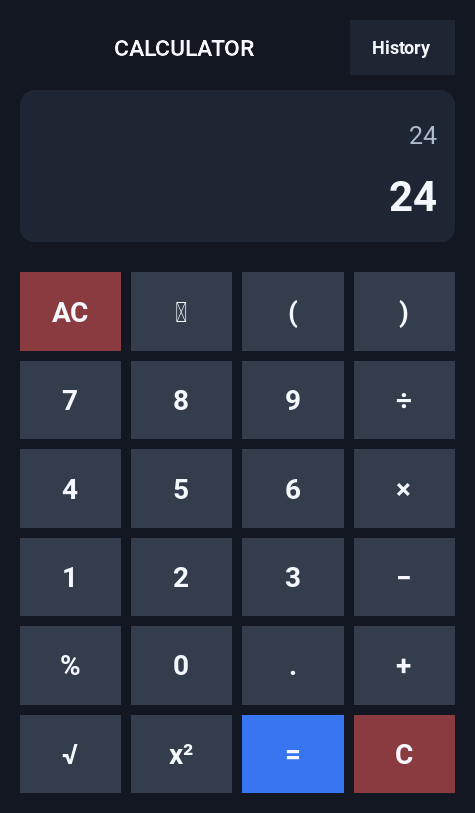
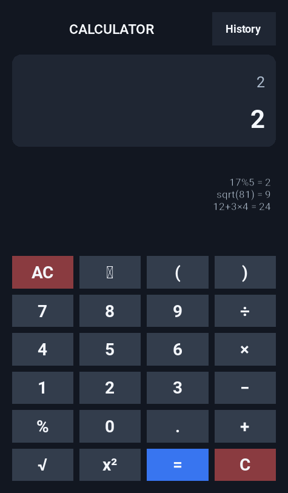

# Project 01 — Python Calculator

A graphical calculator built with **Python and Kivy**. It evaluates arithmetic expressions, supports mouse, touch, and desktop keyboard input, and keeps a scrollable history for the current session. This is the first project in the [Python Basic Projects collection](../README.md).

## Screenshots

The screenshots were captured from the Kivy app running on Windows.

| Calculator keypad                                                                   | Calculation history                                                                  |
| ----------------------------------------------------------------------------------- | ------------------------------------------------------------------------------------ |
|  |  |

## Features

| Feature                       | How it works                                                                                                                                                                                                                                                                                                                       |
| ----------------------------- | ---------------------------------------------------------------------------------------------------------------------------------------------------------------------------------------------------------------------------------------------------------------------------------------------------------------------------------- |
| Basic arithmetic              | Add, subtract, multiply, and divide whole numbers and decimals. Supports positive and negative values, including expressions such as `-8 + 2.5`.                                                                                                                                                                                   |
| Parentheses and precedence    | Group terms with parentheses. `12 + 3 × 4` gives `24`, while `(12 + 3) × 4` gives `60`.                                                                                                                                                                                                                                            |
| Remainder                     | The `%` key calculates modulo. For example, `17 % 5` gives `2`.                                                                                                                                                                                                                                                                    |
| Square root and square        | `√` wraps the current expression in a square root. `x²` squares the current expression. Press `=` to evaluate either operation.                                                                                                                                                                                                    |
| Expression and result display | The two-line display shows the current input and the last result or error. After a successful calculation, the result becomes the starting value for the next operation.                                                                                                                                                           |
| Clear and backspace           | `AC` and `C` both reset the expression and result to zero. `⌫` removes the last character. Clearing the display leaves the session history available.                                                                                                                                                                              |
| Calculation history           | The **History** button opens or closes a scrollable list of up to 20 successful calculations, newest first. History resets when the app restarts.                                                                                                                                                                                  |
| Error messages                | Shows feedback for division by zero, malformed expressions, square roots of negative numbers, and values outside the supported range.                                                                                                                                                                                              |
| Expression evaluator          | Uses Python's `ast` module and accepts only supported numeric operations and square-root calls. Expressions are limited to 160 characters, and individual numeric values and final results are bounded by magnitude. Whole-number results display without a decimal point. Other results display with up to 10 significant digits. |
| Interface                     | Dark theme with a four-column keypad, dedicated clear and delete controls, and a blue equals button.                                                                                                                                                                                                                               |

### Windows keyboard shortcuts

| Keys                    | Action                                  |
| ----------------------- | --------------------------------------- |
| `0–9`, `.`, `(`, `)`    | Type numbers, decimals, and parentheses |
| `+`, `-`, `*`, `/`, `%` | Enter an arithmetic operator            |
| Enter or numpad Enter   | Evaluate the expression                 |
| Backspace               | Delete the last character               |
| Esc                     | Clear the expression and result         |

## Run from source on Windows

From the repository root, run the following in PowerShell with Python installed.

```powershell
cd 01-Calculator
py -m venv .venv
.\.venv\Scripts\python.exe -m pip install -r requirements.txt
.\.venv\Scripts\python.exe main.py
```

## Build the Windows executable

From `01-Calculator`, run the following after setting up the virtual environment.

```powershell
.\.venv\Scripts\python.exe -m pip install pyinstaller
.\.venv\Scripts\python.exe -m PyInstaller --noconfirm --clean Calculator.spec
Copy-Item dist\Calculator.exe builds\windows\Calculator.exe
```

Open `builds/windows/Calculator.exe` to launch the app. Build binaries are gitignored.

## Build an Android debug APK

The project includes [Buildozer configuration](buildozer.spec) for a portrait Android app. Use Linux or Ubuntu under WSL2. In WSL2, keep the working copy in the Linux filesystem. The Android build and device behavior are unverified for this project.

After installing Buildozer and its system dependencies, run the following from `01-Calculator`.

```bash
buildozer -v android debug
ls bin/*.apk
```

The generated APK is written to `bin/` and can be copied to `builds/android/` for local use.

## Run the tests

The unit tests exercise arithmetic and error handling without launching Kivy. Run from `01-Calculator`.

```powershell
.\.venv\Scripts\python.exe -m unittest discover -s tests -v
```

## Project files

| Path                                       | Purpose                                                         |
| ------------------------------------------ | --------------------------------------------------------------- |
| [main.py](main.py)                         | Kivy interface, keypad and keyboard input, display, and history |
| [calculator_logic.py](calculator_logic.py) | Expression validation, evaluation, and result formatting        |
| [tests/](tests/)                           | Unit tests for the calculation logic                            |
| [requirements.txt](requirements.txt)       | Python dependency list                                          |
| [Calculator.spec](Calculator.spec)         | PyInstaller configuration for the Windows executable            |
| [buildozer.spec](buildozer.spec)           | Buildozer configuration for Android                             |
| [builds/](builds/)                         | Local output folders for Windows and Android                    |
| [screenshots/](screenshots/)               | App screenshots shown above                                     |

## 👨‍💻 About the Developer

### Krushna Kale | Python Developer & Tech Enthusiast

Hi, I'm **Krushna Kale**, a passionate developer with a strong interest in **Python Programming, Software Development, Automation, AI, and Cybersecurity**.

I enjoy turning ideas into practical applications, solving real-world problems, and exploring new technologies.

Through my **Python Basic Projects** collection, I aim to strengthen my programming skills, build clean and efficient applications, and share my learning journey with the developer community.

I believe great developers are made through **consistent learning, hands-on practice, and creative problem-solving**.

🚀 **My Mission:** To keep learning, build meaningful projects, and grow as a skilled software developer.

💡 **My Philosophy:** _Learn. Build. Innovate. Repeat._

### 🌐 Connect With Me

- 💻 **GitHub:** [github.com/krushnakaale](https://github.com/krushnakaale)
- 💼 **LinkedIn:** [linkedin.com/in/krushnakaale](https://www.linkedin.com/in/krushnakaale/)
- 📸 **Instagram:** [instagram.com/krushnakaale](https://www.instagram.com/krushna_kaale/)

---

⭐ **Found this project useful? Give the repository a star!**

_Built with dedication, curiosity, and a passion for technology._

**© 2026 Krushna Kale**
