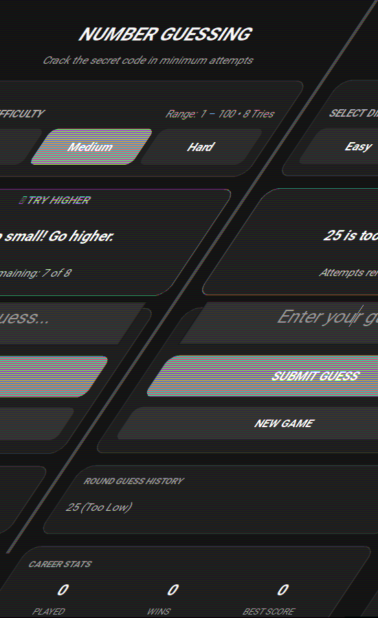
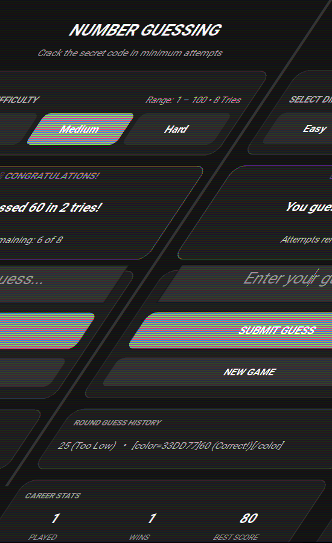

# Number Guessing Game

Project 02 in **Python Basic Projects**, built by **Krushna Kale**. Guess the secret number before you run out of attempts. The Kivy desktop app gives you a higher or lower hint after each incorrect guess.

## Screenshots

| Higher hint | Winning round |
| --- | --- |
|  |  |

Both images were captured from the running professional Kivy interface on Windows.

## Key Features

- **Modern Dark Card UI**: Clean obsidian dark theme with rounded cards and sleek typography.
- **Segmented Difficulty Selector**: Quick toggle between Easy (1–50), Medium (1–100), and Hard (1–200) modes.
- **Dynamic Clue Card**: Color-coded feedback (amber for Higher, cyan for Lower, green for Win, red for Game Over).
- **Round Guess History**: Real-time log of previous guesses with low/high indicators for tactical narrowing.
- **Career Stats Dashboard**: Live tracking of games played, wins, win rate, and all-time best score.
- **Smooth Keyboard & Input Workflow**: Automatic focus retention for fast, frictionless typing and Enter submission.

## Run on Windows

Install Python with pip, then open PowerShell in the `02-Number-Guessing-Game` folder. The desktop app was verified with Python 3.13 and Kivy 2.3.2.

```powershell
python -m venv .venv
.\.venv\Scripts\python.exe -m pip install -r requirements.txt
.\.venv\Scripts\python.exe main.py
```

## How to play

1. Choose a difficulty. Changing difficulty starts a fresh round.
2. Enter a whole number in the displayed range and press **Enter** or click **Guess**.
3. Use the higher or lower hint to narrow the range. Invalid entries leave your attempts unchanged.
4. Click **New Game** to start another round. Scroll down if the bottom controls are below the visible area.

| Difficulty | Range | Attempts |
| --- | --- | ---: |
| Easy | 1 to 50 | 10 |
| Medium | 1 to 100 | 8 |
| Hard | 1 to 200 | 7 |

A win earns **20 points plus 10 points per unused attempt**. Losses score zero. The game saves completed rounds, wins, and the best score to `stats.json` in Kivy's local app data directory.

## Run tests

The game rules use Python's standard library, so these tests can run before installing Kivy.

```powershell
python -m unittest discover -s tests -v
```

## Build a Windows EXE locally

Run these commands in Windows PowerShell from the project folder. You need Python with pip and internet access to install the build dependencies. If you already created `.venv` in the setup steps, reuse it.

```powershell
python -m venv .venv
.\scripts\build_windows.bat
```

The script uses the project's `.venv`, installs Kivy and PyInstaller, then packages `main.py` as a single EXE. After the build succeeds, launch the output to check that it opens and accepts a guess.

```powershell
.\builds\windows\NumberGuessingGame.exe
```

If the script reports that Python is missing, run the virtual environment command again and check that `.venv\Scripts\python.exe` exists. If the EXE cannot be copied because it is in use, close the running game and rerun the build script. PyInstaller writes intermediate files to `build/` and `dist/`. The EXE and these intermediate files are ignored by Git.

## Build an Android debug APK

On Linux or WSL2, copy the project into your Linux home directory. Set up a Linux virtual environment with Buildozer and its system dependencies, then run `bash scripts/build_android.sh` from the project folder. The script uses `buildozer.spec` and copies the APK to `builds/android/`.

## Project structure

```text
02-Number-Guessing-Game/
|-- .gitignore
|-- README.md
|-- main.py                         # Kivy interface and local stats
|-- game_logic.py                   # Difficulty, hints, and scoring
|-- requirements.txt               # Desktop dependencies
|-- buildozer.spec                  # Android packaging configuration
|-- tests/
|   `-- test_game_logic.py
|-- docs/
|   `-- screenshots/
|       |-- higher-hint.png
|       `-- round-won.png
|-- scripts/
|   |-- build_windows.bat
|   `-- build_android.sh
`-- builds/
    |-- windows/
    |   `-- .gitkeep
    `-- android/
        `-- .gitkeep
```

The `.gitkeep` files keep the output folders in the project before anyone builds it.
