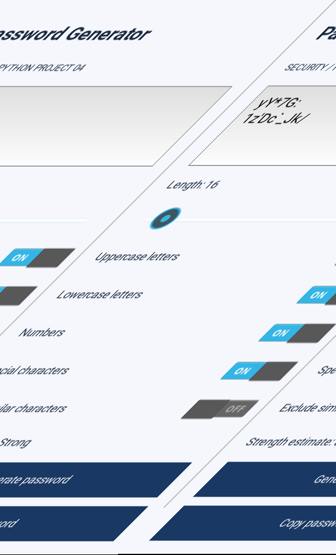
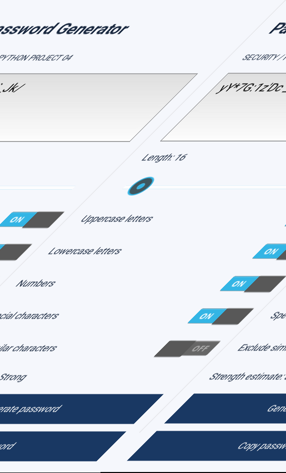

# Project 04 — Password Generator

A clean cross-platform password generator built with Python and Kivy. Uses the standard-library `secrets` module, configurable character groups, length, ambiguous-character filtering, and clipboard copying. The strength label is a simple heuristic, not a security guarantee. No passwords are written to disk by the app; OS clipboard history may retain copied values.

## Screenshots

The screenshots were captured from the running Kivy interface on Windows.

| Default Generator View | Custom Settings & Exclusions |
| ---------------------- | ---------------------------- |
|  |  |

## Windows setup
Use Python 3.11 or 3.12 with Kivy wheels available.

```powershell
py -3.12 -m venv .venv
.\.venv\Scripts\Activate.ps1
python -m pip install -r requirements.txt
python main.py
```

## Tests
```powershell
python -m unittest discover -s tests -v
```

## Windows EXE
With the environment activated, run `.\scripts\build_windows.bat`. Output: `builds/windows/PasswordGenerator.exe`.

## Android APK (WSL Kali Linux)
Install compatible Java (JDK 17 recommended), Python, compiler, zip/unzip, autoconf, automake, libtool, pkg-config, libffi-dev, libssl-dev, zlib development headers and other Buildozer prerequisites. Use a Linux filesystem, not /mnt/e, for builds. A supported Python version and compatible python-for-android toolchain are required; Kali rolling may need additional adjustments.

```bash
mkdir -p ~/Python-Basic-Projects
cp -r /mnt/e/Python-Basic-Projects/Python-Basic-Projects/04-Password-Generator ~/Python-Basic-Projects/
cd ~/Python-Basic-Projects/04-Password-Generator
python3 -m venv .venv-linux
source .venv-linux/bin/activate
pip install buildozer setuptools 'cython<3'
bash scripts/build_android.sh
cp builds/android/*.apk /mnt/e/Python-Basic-Projects/Python-Basic-Projects/04-Password-Generator/builds/android/
```

See https://buildozer.readthedocs.io/en/latest/installation.html for prerequisites. APK is a debug build for testing. Compiled binaries are not included; use GitHub Releases for distribution.

## About the Developer

### Krushna Kale
**Python Developer | Software Development Enthusiast | Tech Explorer**

I'm **Krushna Kale**, an aspiring software developer focused on practical, reliable and user-focused applications. My interests include Python, software engineering, automation, artificial intelligence and cybersecurity. I aim to write clean, maintainable code and improve through hands-on development.

**My Approach:** Learn continuously. Build purposefully. Improve consistently.

| Platform | Profile |
|---|---|
| GitHub | [krushnakaale](https://github.com/krushnakaale) |
| LinkedIn | [krushnakaale](https://www.linkedin.com/in/krushnakaale/) |
| Instagram | [krushnakaale](https://www.instagram.com/krushnakaale/) |

Developed by **Krushna Kale**.
