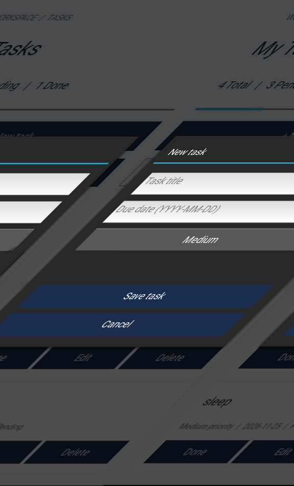

# Project 05 — Smart To-Do List Manager

Project 05 of Python Basic Projects. A local-first Kivy task manager with priorities, due dates, search, filters and completion statistics. Tasks are stored in JSON in the application's user data directory.

## Screenshots

The screenshots were captured from the running Kivy interface on Windows.

| Tasks Overview & Progress | New Task Editor |
| ------------------------- | --------------- |
|  |  |

## Windows (Python 3.11 or 3.12 recommended)

```powershell
py -m venv .venv
.\.venv\Scripts\Activate.ps1
python -m pip install -r requirements.txt
python main.py
python -m unittest discover -s tests
.\scripts\build_windows.bat
```

EXE output: `builds/windows/SmartTodo.exe`.

## Android (Kali WSL2)

Copy the source to the Linux home filesystem, excluding Windows virtual environments. Install compatible Java 17, Android build dependencies and Buildozer as described in https://buildozer.readthedocs.io/en/latest/installation.html . Kali rolling may require a separate compatible Python environment and JDK. Then run:

```bash
python3 -m venv .venv-linux
source .venv-linux/bin/activate
pip install buildozer setuptools 'cython<3'
bash scripts/build_android.sh
```

APK output: `builds/android/`. Copy back to Windows if building in WSL. Debug APK only; no compiled binaries supplied. GUI and packaging require target-platform verification.

## About the Developer

**Krushna Kale | Aspiring Software Developer**

The Python Basic Projects collection reflects my commitment to clean, maintainable code, hands-on learning and practical software development.

*Learn continuously. Build purposefully. Improve consistently.*

[GitHub](https://github.com/krushnakaale) | [LinkedIn](https://www.linkedin.com/in/krushnakaale/) | [Instagram](https://www.instagram.com/krushnakaale/)
