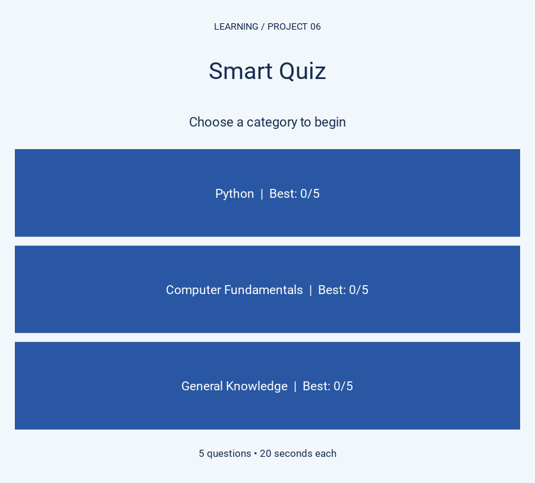
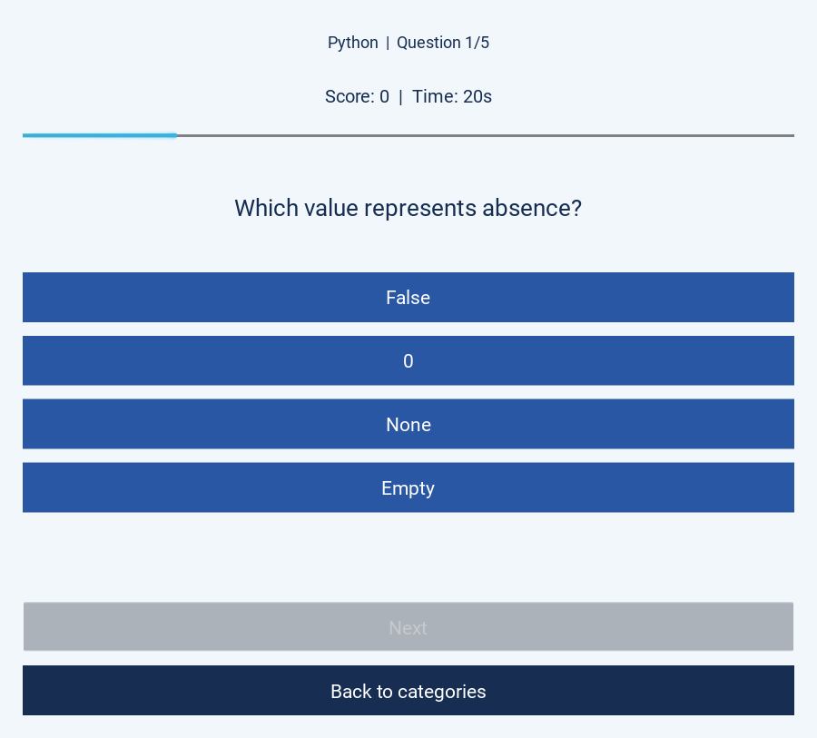
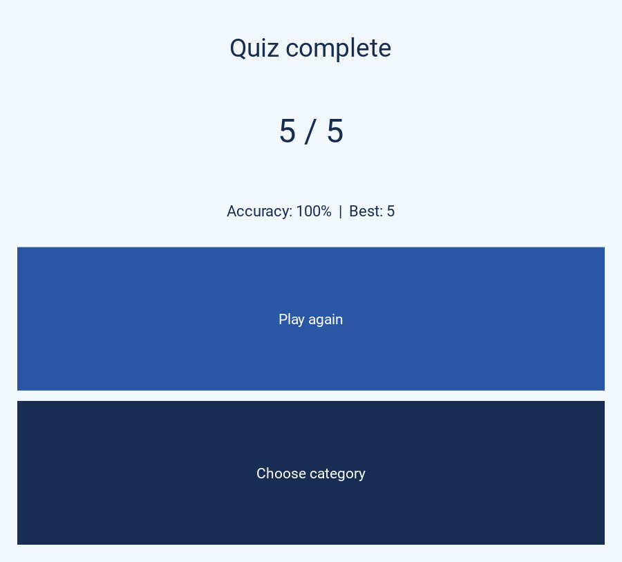

# Smart Quiz App | Project 06

A cross-platform Python/Kivy quiz with 15 questions across three categories, randomized question order, 20-second timer, feedback, accuracy and local best scores.

## Screenshots

### Category selection



### Quiz question



### Results



## Windows (Python 3.11 or 3.12)

```powershell
py -m venv .venv
.\.venv\Scripts\Activate.ps1
python -m pip install -r requirements.txt
python main.py
```

Build EXE with `scripts\build_windows.bat` in the activated environment. Output: `builds/windows/SmartQuiz.exe`.

## Android (Kali WSL2)

Copy the source into your Linux home directory, excluding Windows virtual environments and build caches. Install compatible Java, Python and Android build dependencies following https://buildozer.readthedocs.io/en/latest/installation.html . In a Linux virtual environment install Buildozer, setuptools and compatible Cython, then run `bash scripts/build_android.sh`. Output: `builds/android/`. Copy the APK back to Windows. This is a debug APK; toolchain compatibility may require adjustments.

## Tests

`python -m unittest discover -s tests -v`

## About the Developer

### Krushna Kale

**Python Developer | Software Development Enthusiast | Tech Explorer**

I'm Krushna Kale, an aspiring software developer focused on practical, reliable applications. The Python Basic Projects collection reflects my commitment to clean, maintainable code, continuous learning and hands-on problem-solving.

**My Approach:** Learn continuously. Build purposefully. Improve consistently.

[GitHub](https://github.com/krushnakaale) | [LinkedIn](https://www.linkedin.com/in/krushnakaale/) | [Instagram](https://www.instagram.com/krushnakaale/)
