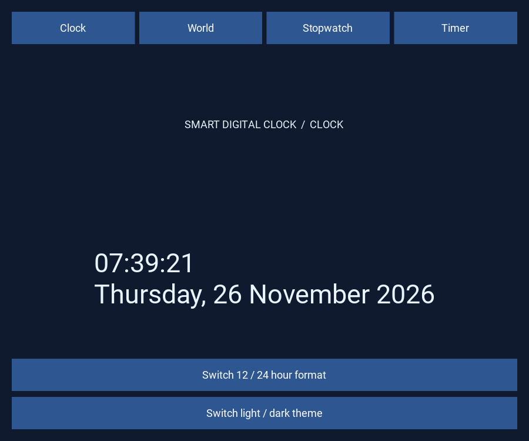
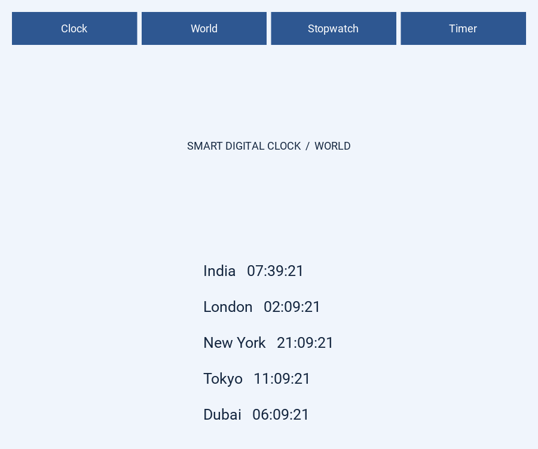
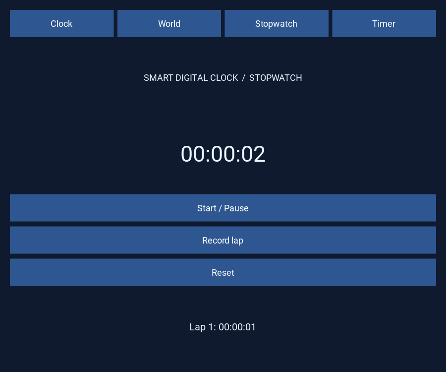
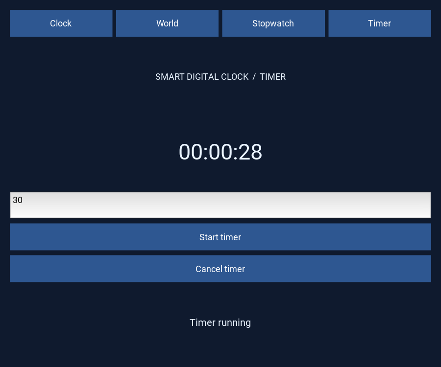

# Project 07 — Smart Digital Clock

A minimal cross-platform clock with world time, stopwatch, laps, countdown and persistent theme settings. Timer feedback is visual; background alarms are not supported.

## Screenshots

### Clock



### World clock



### Stopwatch



### Countdown timer



## Windows

Use Python 3.11 or 3.12.

```powershell
py -m venv .venv
.\.venv\Scripts\Activate.ps1
python -m pip install -r requirements.txt
python main.py
.\scripts\build_windows.bat
```

EXE output: `builds/windows/SmartDigitalClock.exe`.

## Android (Kali WSL2)

Copy source to the Linux home filesystem, excluding Windows virtual environments and build caches. Install compatible Java, compiler and Android build dependencies first.

```bash
python3 -m venv .venv-linux
source .venv-linux/bin/activate
pip install buildozer setuptools 'cython<3'
bash scripts/build_android.sh
```

APK output: `builds/android/`. Android toolchain compatibility depends on the installed versions.

## Tests

`python -m unittest discover -s tests`

## About the Developer

**Krushna Kale | Python Developer & Technology Enthusiast**

The Python Basic Projects collection reflects my commitment to clean, maintainable code, continuous learning and practical software development.

[GitHub](https://github.com/krushnakaale) | [LinkedIn](https://www.linkedin.com/in/krushnakaale/) | [Instagram](https://www.instagram.com/krushna_kaale/)
